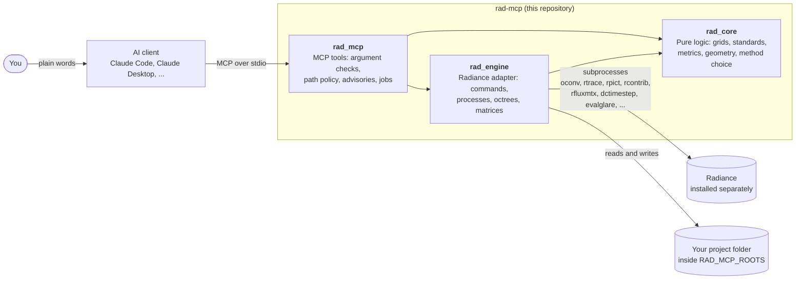
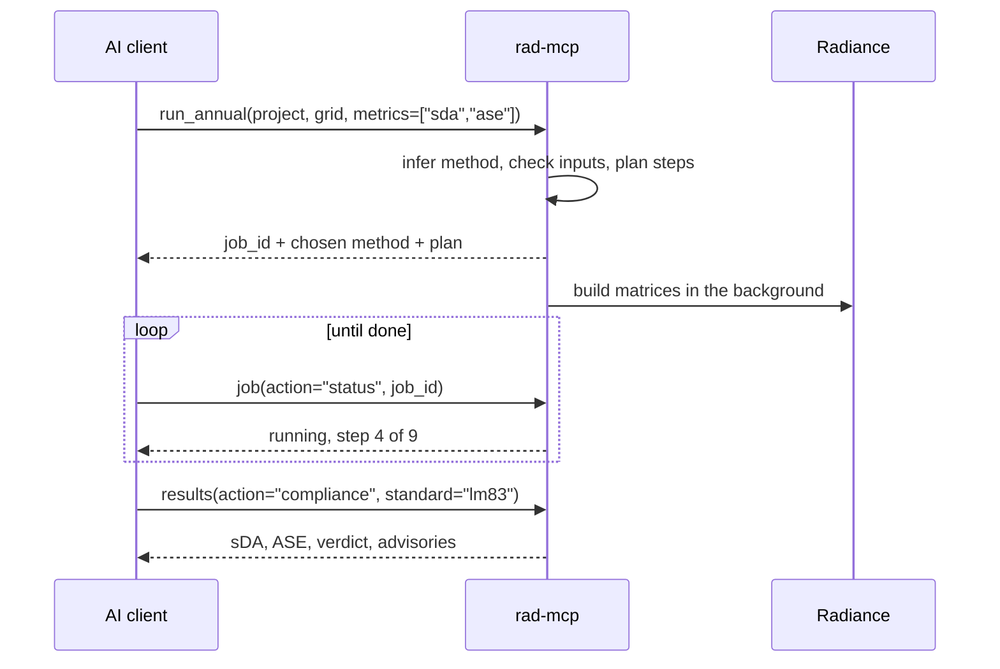
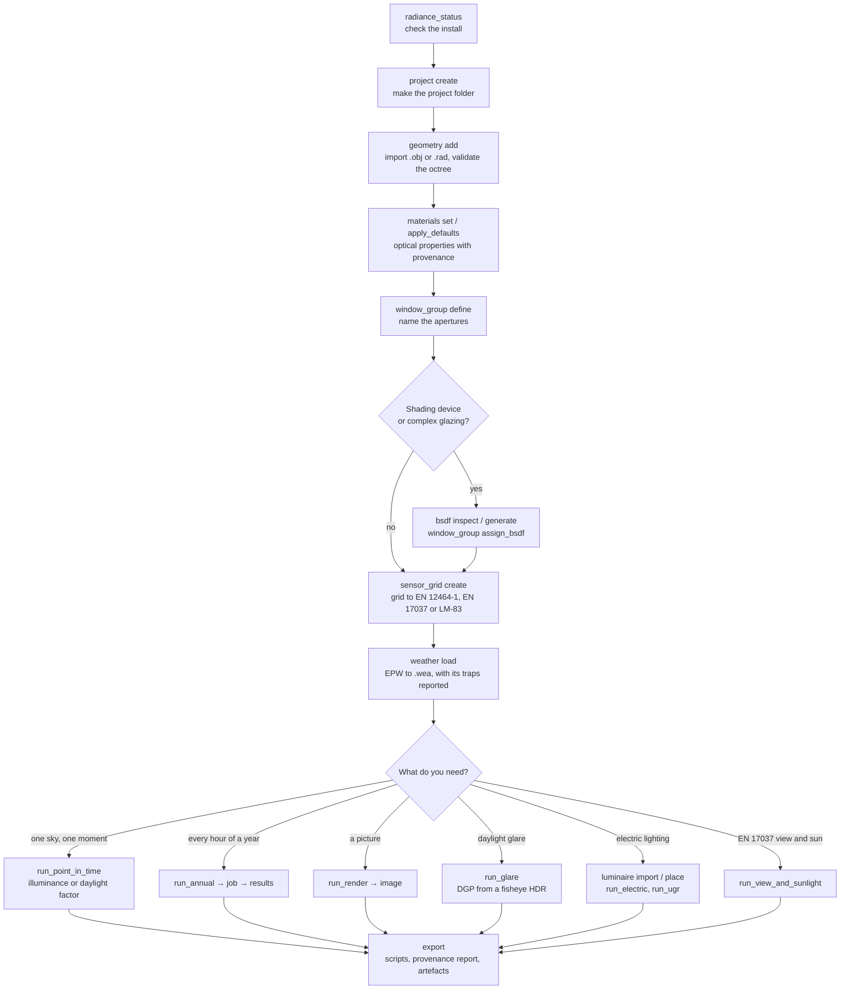
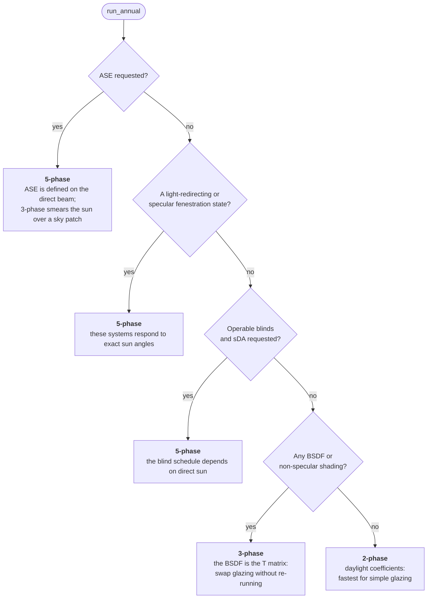
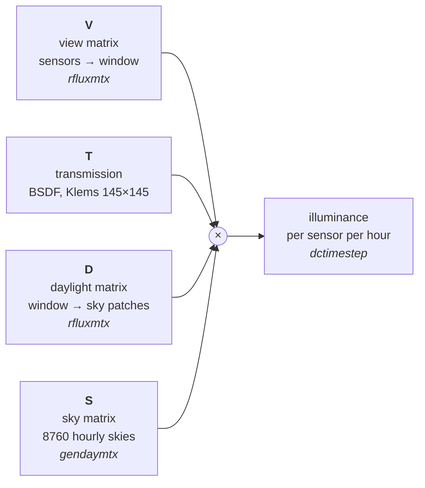

# rad-mcp

[](LICENSE)


**rad-mcp** is a local [Model Context Protocol](https://modelcontextprotocol.io) (MCP) server for
[Radiance](https://www.radiance-online.org), the physically based lighting simulation engine. It lets an AI
assistant such as Claude Code or Claude Desktop run real lighting and daylighting studies on your own models,
on your own computer.

It is built for lighting professionals who know lighting but not every Radiance flag. You ask for a study in
plain words. The assistant calls this server's tools. The server picks the method, runs Radiance, checks every
intermediate file and reports the result together with the assumptions behind it.

- **Annual daylight**: 2-phase daylight coefficients, the 3-phase and 5-phase matrix methods, Klems and
  tensor-tree BSDFs, operable blinds to IES LM-83.
- **Compliance**: sDA, ASE and ASE_net to IES LM-83-12 or ANSI/IES LM-83-22; daylight provision, view out and
  sunlight exposure to EN 17037; electric-lighting uniformity to EN 12464-1; UDI.
- **Images and glare**: `rpict` renders, falsecolor luminance and illuminance maps, daylight glare probability
  (DGP) with `evalglare`, the Unified Glare Rating (UGR) for luminaires.
- **Electric lighting**: IES (LM-63) photometry import, luminaire placement, maintained illuminance.
- **Reproducibility**: every result can be exported as the exact shell script and provenance report that built it.

> **Status: early (0.1.0).** The tools are complete enough for real studies, but the interface may still
> change. Results support, and do not replace, the judgement of a qualified lighting or daylighting consultant.

---

## Contents

- [Install in two lines (Claude Code)](#install-in-two-lines-claude-code)
- [Requirements](#requirements)
- [Configure](#configure)
- [Install for other clients](#install-for-other-clients)
- [How it works](#how-it-works)
- [A typical study](#a-typical-study)
- [How the annual method is chosen](#how-the-annual-method-is-chosen)
- [The tools](#the-tools)
- [The project folder](#the-project-folder)
- [Design rules](#design-rules)
- [The bundled skills](#the-bundled-skills)
- [Troubleshooting](#troubleshooting)
- [Known limits](#known-limits)
- [Licence and third-party material](#licence-and-third-party-material)

---

## Install in two lines (Claude Code)

```text
/plugin marketplace add akontadakis/rad-mcp
/plugin install rad-mcp@rad-mcp
```

Then [set `RAD_MCP_ROOTS`](#configure) in your shell profile and restart Claude Code. The 21 tools are live,
together with the two [bundled skills](#the-bundled-skills).

The plugin starts the server with [`uvx`](https://docs.astral.sh/uv/), which downloads and runs it from this
repository in an isolated environment. You need `uv` on your `PATH` and Radiance installed
(see [Requirements](#requirements)).

---

## Requirements

| What | Version | Why |
|---|---|---|
| **Radiance** | developed and tested against **6.1a**; older versions are untested | The simulation engine. Not bundled: install it yourself from [LBNL-ETA/Radiance releases](https://github.com/LBNL-ETA/Radiance/releases). |
| **Python** | 3.11 or later | Runs the server. `uv` can install it for you. |
| **uv** | any recent | Runs the server with `uvx`. Install from [docs.astral.sh/uv](https://docs.astral.sh/uv/). |
| **Operating system** | macOS or Linux | Developed on macOS (Apple silicon). Linux should work. Windows is not tested. |
| **An MCP client** | Claude Code, Claude Desktop or any stdio MCP client | Talks to the server. |

Radiance is found on your `PATH` first, then under `/usr/local/radiance`, `/usr/local`, `/opt/radiance` and
`/opt/homebrew`. You can also pass its `bin` folder to the `radiance_status` tool. The server sets `RAYPATH` for
every Radiance process it starts, so you do not have to.

Run the `radiance_status` tool first. It reports the Radiance version and which workflows your installation
supports. A missing binary disables only the workflows that need it, not the whole server.

---

## Configure

The server reads and writes files **only inside folders you allow**. Until you set `RAD_MCP_ROOTS`, it refuses
every file path. An unconfigured server does nothing rather than everything.

| Variable | What it does | If unset |
|---|---|---|
| `RAD_MCP_ROOTS` | The folders the server may read and write. Absolute paths, separated by `:`. | Every data path is refused. |
| `RAD_MCP_DEFAULT_ROOT` | Where `project(action="create")` puts a new project when no `root` is given. Must be inside `RAD_MCP_ROOTS`. | That one call needs an explicit `root`. |

Add this to your shell profile (`~/.zshrc` or `~/.bashrc`):

```sh
export RAD_MCP_ROOTS="$HOME/rad-projects"
export RAD_MCP_DEFAULT_ROOT="$HOME/rad-projects"
export PATH="/usr/local/radiance/bin:$PATH"   # if Radiance is not already on PATH
```

Paths are resolved before they are checked, so a symlink inside an allowed folder that points outside it is
refused too.

---

## Install for other clients

### Claude Desktop

Claude Desktop does not read your shell profile, so pass the variables in its config file and use the
absolute path to `uvx` (`which uvx` prints it).

Edit `~/Library/Application Support/Claude/claude_desktop_config.json` on macOS, then restart the app:

```json
{
  "mcpServers": {
    "rad-mcp": {
      "command": "/ABSOLUTE/PATH/TO/uvx",
      "args": ["--from", "git+https://github.com/akontadakis/rad-mcp", "rad-mcp"],
      "env": {
        "RAD_MCP_ROOTS": "/ABSOLUTE/PATH/TO/rad-projects",
        "RAD_MCP_DEFAULT_ROOT": "/ABSOLUTE/PATH/TO/rad-projects",
        "PATH": "/usr/local/radiance/bin:/usr/bin:/bin"
      }
    }
  }
}
```

### Claude Code without the plugin

```sh
claude mcp add rad-mcp \
  -e RAD_MCP_ROOTS="$HOME/rad-projects" \
  -e RAD_MCP_DEFAULT_ROOT="$HOME/rad-projects" \
  -- uvx --from git+https://github.com/akontadakis/rad-mcp rad-mcp
```

This adds the tools only. To also get the skills, use the plugin or copy the folders under `skills/` into
`~/.claude/skills/`.

### Any other MCP client

rad-mcp speaks MCP over **stdio**. Configure your client to start this command, with the two environment
variables set:

```text
uvx --from git+https://github.com/akontadakis/rad-mcp rad-mcp
```

### From a clone

```sh
git clone https://github.com/akontadakis/rad-mcp.git
cd rad-mcp
uv venv && uv pip install -e .
```

Then point your client at `/ABSOLUTE/PATH/TO/rad-mcp/.venv/bin/rad-mcp`.

---

## How it works



The code is split into three Python packages with a strict layer rule:

| Package | Role | May import |
|---|---|---|
| `rad_core` | Pure logic: sensor grids, standards thresholds, metric arithmetic, geometry checks, method inference. No subprocesses, no file system beyond its arguments. | nothing else here |
| `rad_engine` | The Radiance adapter. Every Radiance command line, process group, timeout, octree and matrix lives here. | `rad_core` |
| `rad_mcp` | The MCP layer. Validates arguments, enforces the path policy, turns facts into advisories and shapes every result. | `rad_core`, `rad_engine` |

Short calls run inline and return their result directly. Annual simulations can take hours, so `run_annual`
returns a **job id** at once. You poll it with the `job` tool, and a job survives a server restart.



---

## A typical study



A conversation might go like this:

> *"Create a project called `office-east`, import `~/rad-projects/office.obj` in metres with this material map,
> make the east façade glazing one window group with the venetian blind BSDF, put an LM-83 grid on the floor,
> load the Athens EPW and tell me sDA and ASE."*

The assistant calls the tools in the order above. The server infers the 5-phase method because ASE was asked
for, runs the annual job, applies the LM-83 blind schedule and reports sDA<sub>300/50%</sub> and
ASE<sub>1000,250</sub> with every assumption it made.

---

## How the annual method is chosen

You state the metrics. The server chooses the method, tells you why, and refuses an override that would make
the result wrong.



First match wins. Asking for any method other than 5-phase together with ASE is refused
(`METHOD_OVERRIDE_UNSAFE`). Overriding the other rules is allowed and the reason is recorded.

The 3-phase method multiplies four matrices for every hour of the year:



The 5-phase method adds a direct-sun correction: it removes the patch-averaged sun of the 3-phase result and adds
back a sharp sun computed with real solar positions and a tensor-tree BSDF. Every matrix is cached in the
project and reused when its inputs have not changed.

---

## The tools

21 tools. Every tool that writes or deletes says so in its description and in its MCP annotations.

### Set up

| Tool | Actions | What it does |
|---|---|---|
| `radiance_status` | – | Reports the Radiance install and which workflows it supports. Run it first. |
| `project` | create, list, describe, update, delete, archive | Creates and inspects a project folder and its manifest. `describe` shows which results are still valid. |
| `geometry` | add, list, remove, check | Imports `.obj` (through `obj2rad`, with a JSON material map) or `.rad`, and proves the octree is complete. `oconv` can exit 0 after silently dropping an input; this tool catches it. |
| `materials` | set, list, inspect, apply_defaults | Sets optical properties. Every value carries a provenance: `measured`, `assumed` or `default`. |
| `window_group` | define, list, assign_bsdf, bind_schedule, remove, make_secondary_source | Names the apertures, groups them as LM-83 does and binds BSDF states and blind schedules. |
| `bsdf` | inspect, validate, generate, list | Checks a BSDF XML (Klems or tensor tree) or generates one with `genBSDF`. |
| `sensor_grid` | plan, create, list, remove | Plans and writes a calculation grid to EN 12464-1, EN 17037 or LM-83. The standard is required, because the wrong one gives a plausible grid of the wrong density. |
| `weather` | load, describe, list, remove | Registers an EPW, converts it to `.wea` and reports its traps, such as the sign of the longitude and a zero ground albedo. |
| `luminaire` | import, place, list, remove | Imports IES (LM-63) photometry with `ies2rad` and places luminaires by hand, as arrays or on OBJ faces. |

### Run

| Tool | What it does |
|---|---|
| `run_point_in_time` | Illuminance or daylight factor at a sensor grid for one sky (a CIE sky or a Perez sky from the EPW), or under the placed luminaires. |
| `run_annual` | Annual simulation. Infers the 2-, 3- or 5-phase method, applies LM-83 blinds, returns a job id. |
| `run_render` | Photorealistic HDR renders and falsecolor luminance or illuminance maps with `rpict`, `pfilt` and `falsecolor`. |
| `run_glare` | Daylight glare probability (DGP) from a 180° fisheye with `evalglare`. Refuses low-quality settings, which give a confident but wrong DGP. |
| `run_electric` | Initial and maintained illuminance and U<sub>o</sub> per zone, with the EN 12464-1 limits beside them. |
| `run_ugr` | Unified Glare Rating (CIE 117) for the placed luminaires, measured from the built scene. |
| `run_view_and_sunlight` | EN 17037 view out (5.2) or sunlight exposure (5.3), by casting rays through the window groups. |

### Read, check and hand over

| Tool | Actions | What it does |
|---|---|---|
| `job` | status, wait, list, cancel, logs | Follows an annual run. A cancelled run keeps the matrices it already finished. |
| `results` | summary, points, timeseries, compliance, metrics, blind_schedule, export | Reads an annual result: statistics, per-point values, hourly series, CSV, and verdicts against LM-83 or EN 17037. |
| `image` | inspect, falsecolor, tonemap, convert | Post-processes an HDR you already have, without rendering again. |
| `quality` | presets, explain, diagnose, estimate | Explains Radiance parameters: which flag fixes a splotchy render, what each preset sets. |
| `export` | scripts, report, artifacts, manifest | Writes the exact shell script that rebuilds a result, and a provenance report of every input and assumption. |

---

## The project folder

Every study lives in one folder inside `RAD_MCP_ROOTS`:

```text
my-project/
├── manifest.json        what was built, from what, with which Radiance version
├── 01_geometry/         imported and converted scene files
├── 02_materials/        materials written by the server
├── 03_views/            view files
├── 04_skies/            generated skies and sky matrices
├── 05_bsdf/             BSDF XML files
├── 06_octrees/          frozen octrees and ambient files
├── 07_matrices/         V, D, T, S and the 5-phase direct-sun matrices
├── 08_results/          illuminance results and glare reports
├── 09_images/           renders: hdr/ and ldr/
├── 10_jobs/             background job records and logs
├── 11_sensors/          sensor grid .pts files
├── 12_luminaires/       imported types/ and placements/
└── source.cal           photometric correction file, written when luminaires are imported
```

The manifest records how each artefact was built. When an input changes, the results built from it are marked
stale, and a results read says so instead of returning an old number as if it were current.

---

## Design rules

These rules hold across all tools:

- **No silent defaults.** When the server substitutes a value, the result says so in an `advisories` list with a
  stable code, such as `DEFAULTS_SUBSTITUTED` or `DF_SKY_FORCED`. A default is an assumption about the building,
  not a fact about it.
- **No invented thresholds.** Every limit cites the clause it comes from. Where a standard is silent, the server
  reports the number with no verdict rather than invent one.
- **Refuse rather than mislead.** A wrong-but-plausible result is worse than an error. For example, ASE through
  3-phase is refused, and so is DGP from a low-quality render.
- **Stale results are flagged.** The manifest records what each result was built from. When an input such as a
  window group, a scene include or a blind schedule changes, a results read says the result is not current.
- **Local only.** The server runs on your computer over stdio. It makes no network calls.
- **Path policy.** Every file path is resolved and checked against `RAD_MCP_ROOTS` before it is opened.
- **Safe subprocesses.** Radiance runs with an argument list, never through a shell. Scene files that contain
  `!` command lines are screened before they reach `oconv`.

---

## The bundled skills

The plugin ships two [Claude Code skills](https://docs.claude.com/en/docs/claude-code/skills). They give the
assistant background knowledge so it can use the tools well.

| Skill | What it covers |
|---|---|
| `radiance-simulation-workflow` | The Radiance command line: scene files, ambient parameters, the daylight-coefficient, three-phase and five-phase methods, BSDFs, falsecolor, evalglare and annual metrics. Chapters 9 and 10 adapt the command sequences of A. McNeil's LBNL three- and five-phase tutorials. |
| `lighting-standards-compliance` | What the standards require: EN 12464-1 and -2, EN 17037, IES LM-83-12 and the changes in ANSI/IES LM-83-22, EN 13363, EN 15193. Metrics, thresholds, grids, reference planes and reporting rules, with clause citations. |

The standards skill summarises requirements in its own words and cites clauses. It does not replace the
standards. Buy them from your national standards body or from the IES.

---

## Troubleshooting

| Symptom | Likely cause | Fix |
|---|---|---|
| Every call is refused with a path error | `RAD_MCP_ROOTS` is not set in the server's environment | Set it in your shell profile and restart the client. For Claude Desktop, set it in the config's `env`. |
| `RADIANCE_NOT_FOUND` | Radiance is not on the server's `PATH` | Add Radiance's `bin` folder to `PATH`, or call `radiance_status(bin_dir="/usr/local/radiance/bin")`. |
| The server closes at once (from a clone, macOS) | The editable install's `.pth` file carries the macOS `hidden` flag, and Python 3.11 skips it | `chflags nohidden .venv/lib/python3.*/site-packages/*.pth` |
| `uvx: command not found` | uv is not installed or not on `PATH` | Install uv, or use the absolute path to `uvx` in the client config. |
| Luminaires read about 1000× too dim when you run Radiance by hand | Some Radiance builds' stock `source.cal` drops a photometric multiplier | Inside the server this is handled: it writes its own corrected `source.cal` to the project. |

---

## Known limits

- **Annual glare (annual DGP)** is not built. `run_glare` computes DGP for one view at one moment.
- **LM-83-22** is selectable with `lm83_edition="LM-83-22"`, but a few of its rules are not applied yet, such as
  the 150 lux threshold for less critical tasks and the dirt and mullion factors. Every affected result lists the
  rules it did not apply.
- **`run_point_in_time` and the other inline tools** run synchronously. Only `run_annual` is a background job.
- **Windows** is not tested.
- Some advisory messages and code comments cite internal design notes (`docs/...`, ruling numbers such as
  `R864`) that are not part of this repository. They are references, not instructions; the behaviour they
  describe is what the code does.

---

## Licence and third-party material

rad-mcp is released under the [MIT licence](LICENSE).

- **Radiance** is not included. It is developed by Lawrence Berkeley National Laboratory and distributed under
  the Radiance Software License; install it yourself.
- **`src/rad_engine/data/source.cal`** is derived from Radiance 6.1a's `lib/source.cal`. It keeps its original
  copyright notice, and the Radiance licence is in [`LICENSES/Radiance-License.txt`](LICENSES/Radiance-License.txt).
- Short quotations of Radiance manual pages in code comments are attributed in place and fall under the same
  Radiance licence. The quality presets follow Greg Ward's "rpict options" note in the Radiance documentation.
- **Standards.** Requirements derived from EN 12464-1, EN 12464-2, EN 17037, EN 13363, EN 15193 and IES LM-83 are
  encoded as numbers with clause citations and short attributed quotations. No standard is reproduced. The MIT
  licence covers this project's code and text, not the standards themselves.
- The `radiance-simulation-workflow` skill adapts command sequences from A. McNeil's LBNL tutorials *The
  Three-Phase Method for Simulating Complex Fenestration with Radiance* and the five-phase method tutorial, and
  credits them in place.

---

Made by [Antonis Kontadakis](https://github.com/akontadakis). Issues and pull requests are welcome.
